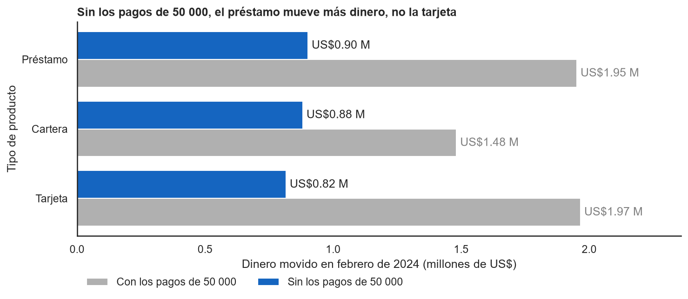
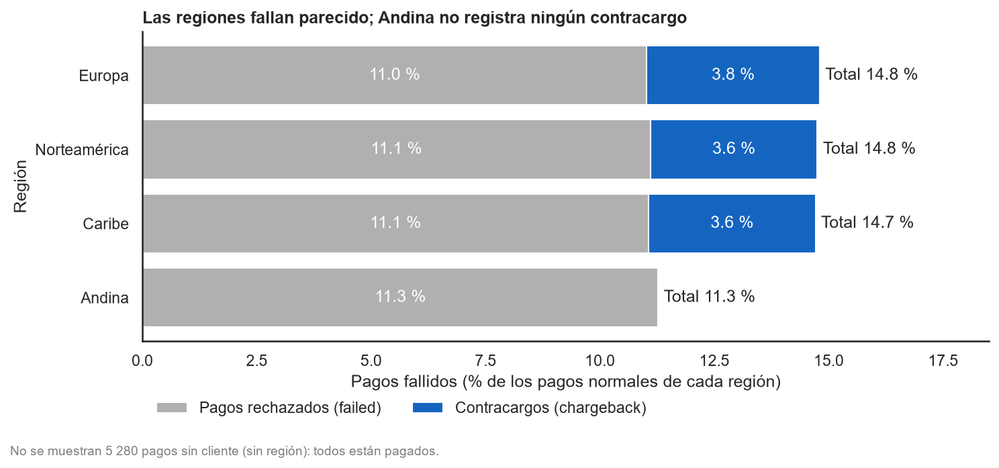
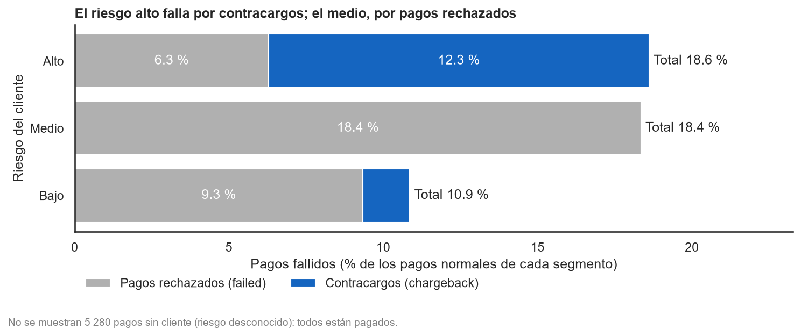
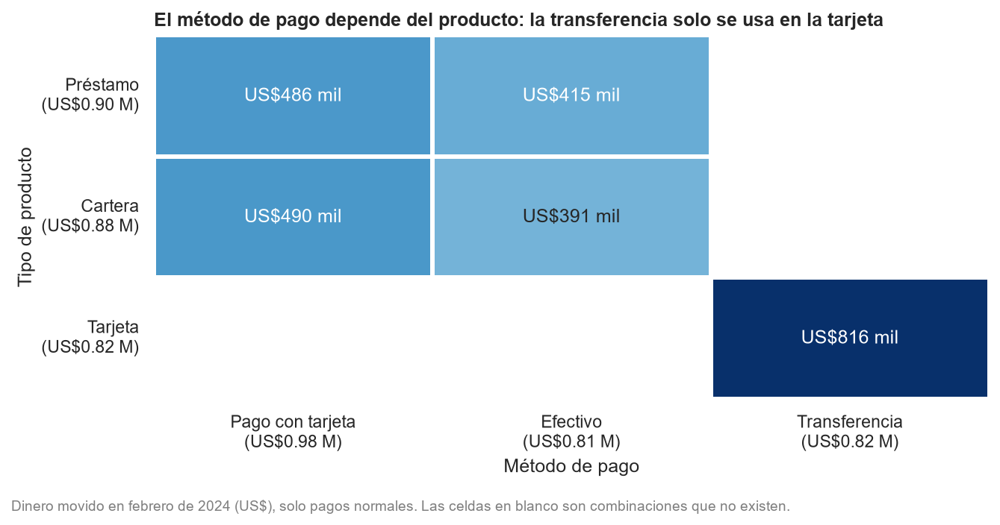

# Análisis de pagos de una fintech

[Read in English](README.md)

> **Hallazgo principal:** sin limpiar, febrero de 2024 parecía un mes de **US$16 millones**. Después de quitar duplicados, montos de relleno y cargos fijos, fueron **US$2.6 millones**, y varias conclusiones de negocio cambian.
> Casi todo lo que parecía raro en los números venía de errores en los datos, no del negocio.

## Objetivo

Limpiar los 100 000 pagos de febrero de 2024 de una fintech, unirlos con los catálogos de productos y regiones, y responder tres preguntas de negocio con cifras y gráficos.

## Cómo correrlo

Necesita [uv](https://docs.astral.sh/uv/).

```bash
git clone https://github.com/roanmetrics-hue/fintech-payments-analysis.git
cd fintech-payments-analysis
uv sync
uv run main.py
```

Sin uv: `pip install pandas numpy matplotlib seaborn` y después `python main.py`. Las versiones usadas están en `pyproject.toml`.

Corre todo en orden: cargar → limpiar → transformar → analizar → graficar. Imprime el resumen de la limpieza y las tablas de cada pregunta, y guarda los 4 gráficos en `graficos/`.

## Datos

| Archivo | Contenido |
|---|---|
| `data/pagos_fintech.csv` | 100 000 pagos del 1 al 24 de febrero de 2024 (14 columnas) |
| `data/productos.csv` | Catálogo de productos |
| `data/regiones.csv` | Catálogo de regiones |

Dataset del [Ciencia de Datos y machine learning], publicado con permiso del profesor. La descripción de las columnas está en [`diccionario_datos.md`](diccionario_datos.md).

## Estructura

| Archivo | Qué hace |
|---|---|
| `limpieza.py` | Carga y limpia los pagos. La bitácora de cada decisión está en ese archivo, debajo de `limpiar()` |
| `analisis.py` | `transformar()` (merges y columnas nuevas) y una función por pregunta, con la respuesta en un comentario |
| `visualizacion.py` | Una función por gráfico; cada una recibe la tabla de su pregunta |
| `main.py` | Corre todo |
| `graficos/` | Los 4 gráficos en PNG |
| `pyproject.toml`, `uv.lock` | Dependencias y versiones exactas |

## Decisiones de limpieza más importantes

- **250 `payment_id` duplicados:** en cada par, una fila cumple `customer_id = payment_id + 1` y la otra no. Se quitó la que no (certeza).
- **277 pagos de exactamente US$50 000:** no son precios reales (el resto va de US$9.99 a US$48.99). 221 estaban en los duplicados; los otros 56 se marcaron y **se excluyen de todos los análisis**.
- **6 300 pagos de −25:** todos del producto 1 y todos pagados. Parecen un cargo fijo, pero no se puede confirmar (supuesto). Se marcaron y no cuentan como dinero ni como pagos en las tasas.
- **6 086 pagos sin datos del cliente:** el pago está completo, solo falta el cliente. Se conservaron y salen aparte como "Sin región" / "Desconocido".

Por eso todas las cifras de abajo usan **solo los pagos normales** (93 394). El análisis por día de la semana usa además solo los que tienen fecha válida.

## Hallazgos

### 1. Sin los pagos de 50 000, el préstamo es el que más dinero mueve (US$0.90 M), no la tarjeta

Con ellos, la tarjeta parecía la primera (US$1.97 M) y el total casi se duplicaba. 56 pagos cambiaban el ranking.



### 2. Las regiones fallan parecido: Europa 14.80 %, Norteamérica 14.76 % y Caribe 14.71 %

La tasa de pagos rechazados es casi igual en todas (~11 %); lo que cambia son los contracargos. **Andina (11.27 %) no tiene ni un contracargo** en 21 873 pagos, aunque vende los mismos productos que Norteamérica, que sí tiene 3.65 %.



### 3. Los clientes de riesgo alto fallan 1.7 veces más que los de riesgo bajo (18.62 % contra 10.86 %), sobre todo por contracargos (12.32 %)

El riesgo medio falla casi igual (18.35 %), pero solo por pagos rechazados, y también tiene 0 contracargos.



### 4. El método de pago depende del producto

La transferencia solo se usa para pagar la tarjeta, y el pago con tarjeta y el efectivo solo para préstamo y cartera. Por eso "la tarjeta es el método que más mueve" no quiere decir que los clientes la prefieran: la usan dos productos.



### 5. El día de la semana no cambia la tasa de fallidos

Con los pagos normales con fecha válida, va de 12.67 % (sábado) a 13.41 % (viernes): menos de 1 punto. Los pagos rechazados (~10 %) y los contracargos (~2.5 %) se mantienen parecidos todos los días. Lo que sí llama la atención: **los pagos con fecha "2024-02-30" fallan más (15.16 % contra 12.98 %)**. *(Solo en tablas, sin gráfico.)*

## Lo que no se puede afirmar

- **Por qué Andina y el riesgo medio no tienen contracargos.** Puede ser que el sistema no los registre ahí; hay que preguntarle al negocio antes de concluir que esos clientes son más confiables.
- **Qué son los −25.** Parecen una comisión fija, pero eso lo tiene que confirmar el negocio.
- **Nada sobre la antigüedad de los clientes:** en 38 754 pagos el cliente se registró después de pagar, así que `signup_dt` no es confiable.
- **Nada por mes:** todos los pagos son de febrero de 2024, por eso no se creó una columna de mes.
- **Poco por día de la semana:** solo hay del 1 al 24 de febrero. Jueves, viernes y sábado aparecen 4 veces y el resto 3, pero el sábado 24 termina a las 3:33 a. m., por eso el sábado tiene 11 835 pagos contra unos 15 000 de jueves y viernes. Con tan pocas fechas, un solo día raro pesa mucho.
- **Por qué los pagos con fecha "2024-02-30" fallan más.** Son 5 549 pagos (5 536 normales) que no se pueden ubicar en ningún día, y fallan 2.2 puntos más que el resto. Puede ser que el sistema ponga esa fecha cuando algo sale mal en el pago; hay que preguntarle al negocio. Si estuvieran concentrados en un día de la semana, el hallazgo 5 podría cambiar.
- Todo describe estos 100 000 pagos de febrero de 2024; no se puede generalizar a otros meses.

## Habilidades aplicadas

- **pandas:** carga con control de nulos, groupby, tablas dinámicas, máscaras booleanas
- **Limpieza de datos** con bitácora de decisiones (problema, patrón, grado de certeza, decisión)
- **Merges con validación:** `validate="many_to_one"`, indicador de merge y control del número de filas
- **Marcas de calidad de datos:** las filas dudosas se marcan en vez de borrarse, y se mide su efecto en cada métrica
- **matplotlib / seaborn:** gráficos cuyo título dice el hallazgo
- **Entorno reproducible** con uv (`pyproject.toml` + `uv.lock`)
