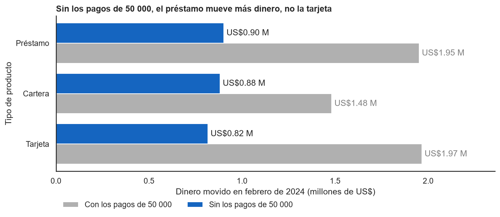
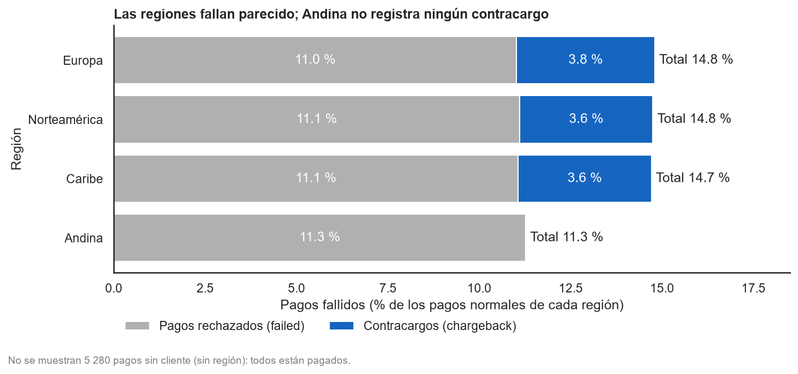
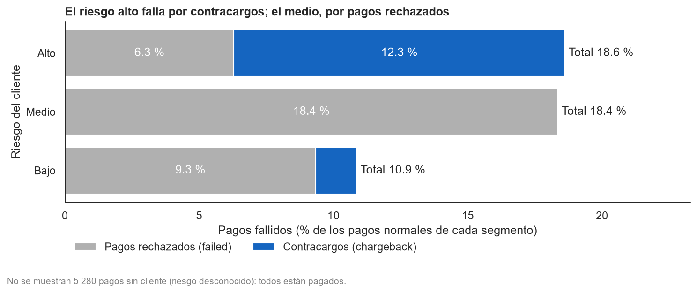
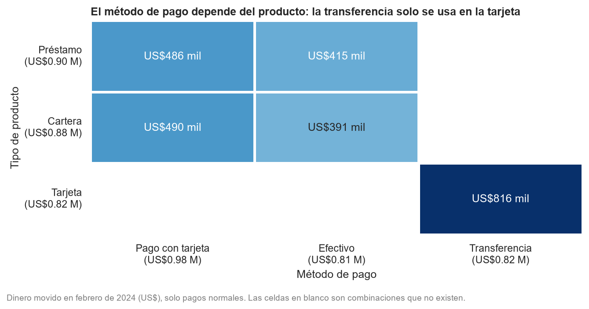

# Fintech Payments Analysis

[Leer en español](README.es.md)

> **Main finding:** before cleaning, February 2024 looked like a **US$16 million** month. After removing duplicates, placeholder amounts and fixed fees, it was **US$2.6 million**, and several business conclusions flip.
> Most of what looked unusual in the numbers came from data errors, not from the business.

## Goal

Clean 100,000 payments from a fintech (February 2024), join them with the product and region catalogs, and answer three business questions with figures and charts.

## How to run

Requires [uv](https://docs.astral.sh/uv/).

```bash
git clone https://github.com/roanmetrics-hue/fintech-payments-analysis.git
cd fintech-payments-analysis
uv sync
uv run main.py
```

Without uv: `pip install pandas numpy matplotlib seaborn`, then `python main.py`. The versions used are in `pyproject.toml`.

The script runs everything in order: load → clean → transform → analyze → plot. It prints the cleaning summary and one table per question, and saves the 4 charts to `graficos/`.

*Code, comments and charts are in Spanish.*

## Data

| File | Content |
|---|---|
| `data/pagos_fintech.csv` | 100,000 payments, February 1–24, 2024 (14 columns) |
| `data/productos.csv` | Product catalog |
| `data/regiones.csv` | Region catalog |

Dataset provided by [Data Sciencie & Machine learning], published with the instructor's permission. Column descriptions are in [`diccionario_datos.md`](diccionario_datos.md) (in Spanish).

## Project structure

| File | What it does |
|---|---|
| `limpieza.py` | Loads and cleans the payments. The decision log for every step is in this file, right below `limpiar()` |
| `analisis.py` | `transformar()` (merges and new columns) and one function per question, with the answer in a comment |
| `visualizacion.py` | One function per chart; each one receives the table for its question |
| `main.py` | Runs everything |
| `graficos/` | The 4 charts as PNG |
| `pyproject.toml`, `uv.lock` | Dependencies and exact versions |

## Key cleaning decisions

- **250 duplicated `payment_id`:** in each pair, one row follows `customer_id = payment_id + 1` and the other does not. The one that does not was removed (certain).
- **277 payments of exactly US$50,000:** not real prices (all other payments range from US$9.99 to US$48.99). 221 were in the duplicates; the remaining 56 were flagged and **excluded from all analyses**.
- **6,300 payments of −25:** all from product 1, all paid. They look like a fixed fee, but this cannot be confirmed (assumption). They were flagged and do not count as money or as payments in the rates.
- **6,086 payments without customer data:** the payment is complete; only the customer is missing. They were kept and reported separately as "Sin región" / "Desconocido" (no region / unknown).

That is why every figure below uses **normal payments only** (93,394). The day-of-week analysis also uses only payments with a valid date.

## Findings

### 1. Without the US$50,000 payments, loans move the most money (US$0.90M), not cards

With those payments included, the Card product looked like the leader (US$1.97M) and the total roughly doubled. Just 56 payments changed the ranking.



### 2. Regions fail at similar rates: Europe 14.80%, North America 14.76%, Caribbean 14.71%

The declined-payment rate is almost the same everywhere (~11%); what differs is chargebacks. **The Andean region (11.27%) has zero chargebacks** in 21,873 payments, even though it sells the same products as North America, which has 3.65%.



### 3. High-risk customers fail 1.7 times more than low-risk ones (18.62% vs 10.86%), mostly through chargebacks (12.32%)

Medium-risk customers fail almost as much (18.35%), but only through declined payments, and they also have zero chargebacks.



### 4. The payment method depends on the product

Bank transfer is only used to pay the Card product, while card payments and cash are only used for Loan and Wallet. So "card is the method that moves the most money" does not mean customers prefer it: two products use it.



### 5. The day of the week does not change the failure rate

Among normal payments with a valid date, it ranges from 12.67% (Saturday) to 13.41% (Friday): less than 1 point. Declined payments (~10%) and chargebacks (~2.5%) stay similar every day. What does stand out: **payments dated "2024-02-30" fail more (15.16% vs 12.98%)**. *(Tables only, no chart.)*

## What cannot be claimed

- **Why the Andean region and the medium-risk segment have no chargebacks.** The system may simply not record them there; the business should confirm this before concluding those customers are more reliable.
- **What the −25 payments are.** They look like a fixed fee, but the business has to confirm it.
- **Anything about customer tenure:** in 38,754 payments the customer signed up *after* paying, so `signup_dt` is not reliable.
- **Anything by month:** all payments are from February 2024, so no month column was created.
- **Little by day of the week:** data only covers February 1–24. Thursday, Friday and Saturday appear 4 times and the other days 3, but Saturday the 24th ends at 3:33 a.m., so Saturday has 11,835 payments versus about 15,000 on Thursday and Friday. With so few dates, a single unusual day carries a lot of weight.
- **Why payments dated "2024-02-30" fail more.** There are 5,549 of them (5,536 normal) that cannot be placed on any day, and they fail 2.2 points more than the rest. The system may assign that date when something goes wrong with the payment; the business should be asked. If they were concentrated on one weekday, finding 5 could change.
- Everything describes these 100,000 payments from February 2024; it cannot be generalized to other months.

## Skills demonstrated

- **pandas:** data loading with controlled null handling, groupby, pivot tables, boolean masks
- **Data cleaning** with a documented decision log (problem, pattern, level of certainty, decision)
- **Merges with validation:** `validate="many_to_one"`, merge indicator and a row-count check
- **Data quality flags:** questionable rows are flagged instead of deleted, and their impact on each metric is measured
- **matplotlib / seaborn:** charts whose title states the finding
- **Reproducible environment** with uv (`pyproject.toml` + `uv.lock`)
